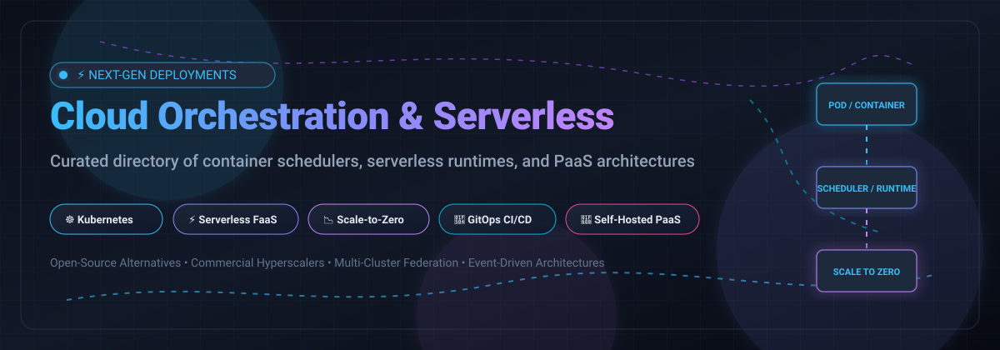

  

# Awesome Cloud Orchestration & Serverless Deployments 🚀⚡

> **A curated, battle-tested index of open-source container schedulers, serverless FaaS frameworks, cloud-native runtimes, and developer PaaS deployments.**

🌟 **Star this repository if you find it valuable!** 🌟

---

Modern cloud orchestration and serverless deployment architectures empower engineering teams to scale, automate, and orchestrate containers and event-driven functions globally with high availability and instant scale-to-zero capabilities. While hosted commercial hyperscalers like **AWS ECS/Fargate**, **Google Cloud Run**, and **Azure Container Apps** deliver fully managed workflows, a robust open-source ecosystem powered by **Kubernetes**, **K3s**, **Nomad**, **Knative**, **Coolify**, **OpenFaaS**, and **Argo CD** provides absolute infrastructure sovereignty, avoiding vendor lock-in.

This guide provides an SEO-optimized, thoroughly categorized overview distinguishing commercial hosted SaaS platforms from community-driven open-source software, complete with enterprise pricing tiers, free quotas, and real-time GitHub popularity.

---

## 📑 Table of Contents

- [📊 Sector Overview & Market Dynamics](#-sector-overview--market-dynamics)
- [🏢 SaaS / Hosted Platforms](#-saas--hosted-platforms)
- [🌐 Open-Source GitHub Projects](#-open-source-github-projects)
  - [☸️ Container Orchestration & Scheduling Engines](#️-container-orchestration--scheduling-engines)
  - [⚡ Serverless FaaS & Autoscaling Platforms](#-serverless-faas--autoscaling-platforms)
  - [🚀 Self-Hosted PaaS & Developer Deployment Platforms](#-self-hosted-paas--developer-deployment-platforms)
  - [🔄 GitOps, Continuous Delivery & Workflow Orchestration](#-gitops-continuous-delivery--workflow-orchestration)
- [💡 Architectural Guidance: How to Choose](#-architectural-guidance-how-to-choose)
- [📈 Star History](#-star-history)
- [💖 Support & Sponsorship](#-support--sponsorship)
- [🤝 How to Contribute](#-how-to-contribute)
- [⚖️ Disclaimer](#️-disclaimer)

---

## 📊 Sector Overview & Market Dynamics

The global cloud container orchestration market is valued between **$1.4B and $10B+** (growing at an ~18%–24% CAGR), while the serverless computing sector is valued at **$22B to $32B+** (accelerating toward $44B–$90B+ at a ~15%–23% CAGR). 

The industry exhibits a **concentrated core** where the top three cloud hyperscalers (Amazon Web Services, Microsoft Azure, and Google Cloud Platform) capture over 65% of enterprise container and function spend. In parallel, a **moderately fragmented periphery** of high-growth independent PaaS solutions (such as Railway, Fly.io, and Scaleway) and open-source self-hostable tools (such as Coolify, Dokku, and K3s) provide tailored developer experiences, data sovereignty, and reduced cloud margins.

---

## 🏢 SaaS / Hosted Platforms

Below is a breakdown of major commercial or fully managed cloud orchestration and serverless platforms (closed-source / hosted), sorted in **descending order by company size** (market capitalization / enterprise valuation):

| Platform | Provider / Parent | Company Size (Valuation / Revenue) | Starting Tier Pricing | Free Tier / Trial Limits | Description |
| :--- | :--- | :--- | :--- | :--- | :--- |
| **[Azure Container Apps](https://azure.microsoft.com/en-us/products/container-apps)** | Microsoft | ~$3.8T Market Cap (~$245B+ ARR) | Pay-as-you-go from $0.000024/vCPU-s ($0.0864/vCPU-hr) active compute + $0.000003/GiB-s memory | **Free Forever:** 180,000 vCPU-seconds (~50 vCPU-hrs), 360,000 GiB-seconds (~100 GiB-hrs), and 2M HTTP requests per month. | Serverless container platform built on Kubernetes & KEDA, scaling to zero without managing underlying infrastructure. |
| **[Google Cloud Run](https://cloud.google.com/run)** | Google (Alphabet) | ~$3.4T Market Cap (~$350B+ ARR) | Pay-as-you-go from $0.000024/vCPU-s ($0.0864/vCPU-hr) request-based compute + $0.0000025/GiB-s memory | **Free Forever:** 180,000 vCPU-seconds (~50 vCPU-hrs), 360,000 GiB-seconds, 2M requests, and 1 GB egress/mo. | Fully managed serverless container runtime that executes containers directly via HTTP requests with instant scale-to-zero. |
| **[AWS ECS](https://aws.amazon.com/ecs/) + Fargate** | Amazon (AWS) | ~$2.8T Market Cap (~$105B+ AWS ARR) | Pay-as-you-go from $0.04048 per vCPU-hour + $0.004445 per GB-hour (US East Linux/x86) | **No Free vCPU Tier:** Compute billed from first second; includes 20 GB free ephemeral storage per task/pod (EC2 Free Tier offers 750 hrs/mo on t2/t3.micro). | Amazon's fully managed container orchestration service offering serverless container execution via AWS Fargate. |
| **Managed Kubernetes (EKS / GKE / AKS)** | AWS / Google / Microsoft | Hyperscalers ($2.8T – $3.8T Market Cap) | Control plane from $0.00/hr (AKS Free Tier) to $0.10/cluster-hour (~$73/mo for EKS/GKE) + underlying worker node compute | **Varies by Provider:** AKS has permanent free control plane ($0 SLA); GKE gives $74.40/mo credit (covers 1 Zonal/Autopilot cluster); EKS has no free tier (12-month AWS Free Tier only covers EC2 nodes). | Managed enterprise Kubernetes control planes automating cluster provisioning, upgrades, and high availability. |
| **[Red Hat OpenShift](https://www.redhat.com/en/technologies/cloud-computing/openshift)** | IBM (Red Hat) | $34B Acquisition ($190B+ IBM Market Cap, Red Hat ARR ~$4B+) | Self-managed subscriptions start at core-pair licensing (~$1,000–$2,000+/core-pair/yr); ROSA/ARO managed cloud starts at hourly compute add-on (~$0.07–$0.17/vCPU-hr) | **60-Day Free Trial:** Full product access on own infrastructure; or free Developer Sandbox (shared hosted environment renewable in 30-day blocks with 12-hr pod timeout). | Enterprise Kubernetes application platform with developer tooling, security, and multicloud deployment capabilities. |
| **[HashiCorp Nomad Enterprise / Cloud (HCP)](https://www.hashicorp.com/products/nomad)** | IBM (HashiCorp) | $6.4B Acquisition ($580M+ ARR) | Self-hosted Community Edition is free (BSL); HCP Nomad managed clusters start at hourly development tiers (~$0.05–$0.15/cluster-hr) | **Free Forever (Self-Hosted):** Nomad binary free to self-manage; HCP Cloud provides a 30-day trial with $500 free credits across HashiCorp Cloud Platform services (no permanent free managed cluster). | Workload orchestrator deploying containers, non-containerized legacy binaries, and microservices across hybrid infrastructures. |
| **[Rancher Prime](https://www.rancher.com/)** | SUSE (EQT) | ~$2.9B Take-Private Valuation (~$778M ARR) | Open-source core is free; SUSE Rancher Prime subscriptions start around €2,113/yr per 2-core/4-vCPU block; AWS Marketplace edition starts at ~$168/mo for 24 vCPUs | **Free Forever (Community Edition):** Unrestricted full open-source cluster management; Rancher Prime offers a 30-day free trial on AWS Marketplace / SUSE customer portal. | Complete multi-cluster management stack for running containers across on-prem bare-metal, edge devices, and public clouds. |
| **[Scaleway Serverless](https://www.scaleway.com/)** | Scaleway (Iliad Group) | €11B+ Iliad Market Cap (Scaleway ARR ~€150M) | Serverless Containers start at €0.00001/vCPU-s (€0.036/vCPU-hr) + €0.000002/GB-s; Functions at €0.000005/GB-s + €0.15/1M requests | **Free Forever:** 200,000 vCPU-seconds and 400,000 GB-seconds free monthly for Containers; 400,000 GB-seconds and 1,000,000 requests free monthly for Functions. | European sovereign cloud platform providing managed serverless container execution and serverless micro-functions. |
| **[Railway](https://railway.app/)** | Railway | ~$500M–$1B Valuation ($124M funding, ~2M users) | Hobby plan starting at **$5.00/month** (includes $5 of resource credits, then $20/vCPU-mo & $10/GB RAM-mo) | **Free Forever:** $1.00/mo recurring resource credit, 1 project with up to 3 services (up to 0.5 GB RAM, 1 vCPU, auto-sleep after idle) plus a 30-day initial trial with $5 credit. | Developer-centric PaaS providing instant git-based deployments, automated container builds, and database provisioning. |
| **[Fly.io](https://fly.io/)** | Fly.io | ~$470M Valuation ($136M funding, ~$12M ARR) | Pay-as-you-go starting at ~$2.19/month for continuous `shared-cpu-1x` (256MB RAM) micro-machine; Hobby subscription at $5.00/month | **Pay-As-You-Go / Trial:** No permanent free VM plan for new accounts ($1 trial credit / pay-per-second); includes free perpetual 10 GB volume snapshots, 10 SSL certificates, and shared IPv4/IPv6. | Global application delivery platform running micro-VM containers directly on bare metal close to users. |

---

## 🌐 Open-Source GitHub Projects

Explore the top self-hostable and open-source container schedulers, serverless platforms, PaaS alternatives, and GitOps engines. **Each category is strictly sorted in descending order by GitHub Stars_Count**, with verified Stars_Badges linking directly to each repository's stargazers.

### ☸️ Container Orchestration & Scheduling Engines

- **[kubernetes/kubernetes](https://github.com/kubernetes/kubernetes)**   
  The industry-standard production container orchestrator. Automates declarative deployment, automated rollout/rollback, service discovery, load balancing, and storage orchestration at petabyte scale. (Apache-2.0)

- **[moby/moby](https://github.com/moby/moby)**   
  The open-source framework and upstream component collection for container systems, including Docker Engine and Docker Swarm for lightweight native clustering. (Apache-2.0)

- **[k3s-io/k3s](https://github.com/k3s-io/k3s)**   
  Highly available, certified lightweight Kubernetes distribution packed into a single `<100MB` binary. Optimized for edge, IoT, ARM devices, and resource-constrained environments. (Apache-2.0)

- **[rancher/rancher](https://github.com/rancher/rancher)**   
  Complete enterprise multi-cluster management control plane. Manages downstream clusters across AWS EKS, Google GKE, Azure AKS, and bare-metal RKE2 clusters under a single glass pane. (Apache-2.0)

- **[hashicorp/nomad](https://github.com/hashicorp/nomad)**   
  Simple, flexible, and high-performance workload orchestrator. Deploys Docker containers, raw executables, Java JARs, and Windows applications across cloud and bare-metal environments. (BSL 1.1)

---

### ⚡ Serverless FaaS & Autoscaling Platforms

- **[openfaas/faas](https://github.com/openfaas/faas)**   
  Serverless Functions-as-a-Service framework designed around Docker containers. Deploy any language runtime to Kubernetes or K3s with built-in metrics, event connectors, and automated scaling. (MIT)

- **[kedacore/keda](https://github.com/kedacore/keda)**   
  Kubernetes Event-driven Autoscaling (CNCF Graduated). Drives container scaling from 0 to N instances based on events from Kafka, RabbitMQ, Redis, AWS SQS, Azure Service Bus, and 60+ scalers. (Apache-2.0)

- **[fission/fission](https://github.com/fission/fission)**   
  Fast, developer-friendly serverless framework for Kubernetes. Features instant cold-starts (<100ms) by utilizing pre-warmed container pools, live reloading, and automated ingress. (Apache-2.0)

- **[apache/openwhisk](https://github.com/apache/openwhisk)**   
  Distributed, event-driven serverless compute platform. Executes actions in response to HTTP feeds, message brokers, and database mutations with robust concurrency and sequence chaining. (Apache-2.0)

- **[knative/serving](https://github.com/knative/serving)**   
  Kubernetes-native request-driven compute runtime. Adds automated scale-to-zero, traffic splitting (canary rollouts), and revision management; acts as the foundation for Google Cloud Run. (Apache-2.0)

- **[nuclio/nuclio](https://github.com/nuclio/nuclio)**   
  High-performance serverless event and data processing platform designed for real-time streaming, GPU acceleration, and AI/ML inference workloads with minimal CPU overhead. (Apache-2.0)

---

### 🚀 Self-Hosted PaaS & Developer Deployment Platforms

- **[coollabsio/coolify](https://github.com/coollabsio/coolify)**   
  Self-hostable, all-in-one open-source alternative to Heroku, Netlify, and Vercel. Deploy applications, databases, and Docker services onto your own servers via SSH and Git push. (Apache-2.0)

- **[dokku/dokku](https://github.com/dokku/dokku)**   
  The smallest PaaS implementation you've ever seen. Docker-powered Heroku clone that enables single-command git-push deployments to any Debian/Ubuntu server with SSL automation. (BSD-3-Clause)

- **[caprover/caprover](https://github.com/caprover/caprover)**   
  Extremely easy to use app/database deployment and web server manager. Supports clustering with Docker Swarm, automated Let's Encrypt certificates, and one-click app store templates. (Apache-2.0)

- **[basecamp/kamal](https://github.com/basecamp/kamal)**   
  Zero-downtime container deployment tool built by 37signals. Deploys Dockerized web apps directly to bare-metal servers or cloud VMs using Traefik and SSH without heavy cluster agents. (MIT)

---

### 🔄 GitOps, Continuous Delivery & Workflow Orchestration

- **[argoproj/argo-cd](https://github.com/argoproj/argo-cd)**   
  Declarative, GitOps continuous delivery tool for Kubernetes (CNCF Graduated). Synchronizes Kubernetes cluster manifests with Git repositories in real-time with visual status dashboards. (Apache-2.0)

- **[argoproj/argo-workflows](https://github.com/argoproj/argo-workflows)**   
  Container-native workflow engine for orchestrating parallel batch computing, ETL data pipelines, and machine learning model training on Kubernetes using Directed Acyclic Graphs (DAGs). (Apache-2.0)

- **[fluxcd/flux2](https://github.com/fluxcd/flux2)**   
  Open and extensible continuous delivery solution for Kubernetes powered by GitOps Toolkit. Automates state reconciliation with Git repositories, Helm charts, and OCI container artifacts. (Apache-2.0)

---

## 💡 Architectural Guidance: How to Choose

- **Need Enterprise Standard & Scalability?** Choose **[Kubernetes](https://github.com/kubernetes/kubernetes)** or **[K3s](https://github.com/k3s-io/k3s)** paired with **[Argo CD](https://github.com/argoproj/argo-cd)** for declarative GitOps continuous deployments.
- **Need Mixed Legacy Binaries + Containers?** Choose **[Nomad](https://github.com/hashicorp/nomad)** for a single-binary architecture with lower operational complexity than Kubernetes.
- **Need Serverless Functions / Scale-to-Zero?** Deploy **[Knative](https://github.com/knative/serving)** or **[OpenFaaS](https://github.com/openfaas/faas)** for request-driven compute and automated downscaling.
- **Need a Self-Hosted Heroku / Vercel Alternative?** Choose **[Coolify](https://github.com/coollabsio/coolify)** for a modern web GUI or **[Dokku](https://github.com/dokku/dokku)** / **[Kamal](https://github.com/basecamp/kamal)** for lightweight SSH/git-push pipelines.

---

## 📈 Star History

---

## 💖 Support & Sponsorship

Thank you for exploring and utilizing this open-source deployment directory! If this curated guide saved you time or aided your architectural decisions, please consider supporting the project:

- 🌟 **Star the repository** to boost discovery for fellow cloud architects and DevOps engineers.
- 🍴 **Fork the project** and submit additions or improvements via Pull Requests.
- 📢 **Share with your team** or tech communities on LinkedIn, X/Twitter, and Discord.
- ☕ **Sponsor & Buy a Coffee:** You can support continuous maintenance and new open-source initiatives via the [GitHub Sponsor Dashboard](https://github.com/sponsors/ishandutta2007).

---

## 🤝 How to Contribute

Contributions are welcome and highly appreciated!

1. **Fork the repository** to your personal GitHub account.
2. Ensure new additions belong in either the **SaaS / Hosted Platforms** table or the **Open-Source GitHub Projects** categories.
3. Follow the established format:
   - For Open-Source: Include the full repository link `[org/repo](url)`, the Stars_Count social badge ``, and concise technical bullets detailing license and features.
4. Verify all hyperlinks, badges, and markdown formatting.
5. Open a Pull Request detailing your additions.

---

## ⚖️ Disclaimer

This repository is a community-curated directory for architectural research, educational, and informational purposes only. Mentions of commercial SaaS platforms or specific open-source licenses do not constitute formal commercial endorsements. Always review licensing terms, pricing sheets, cloud operational costs, and security requirements prior to rolling infrastructure into production environments.

---

**Built with ❤️ for DevOps engineers, Cloud Architects, and the Global Open-Source Community.**

